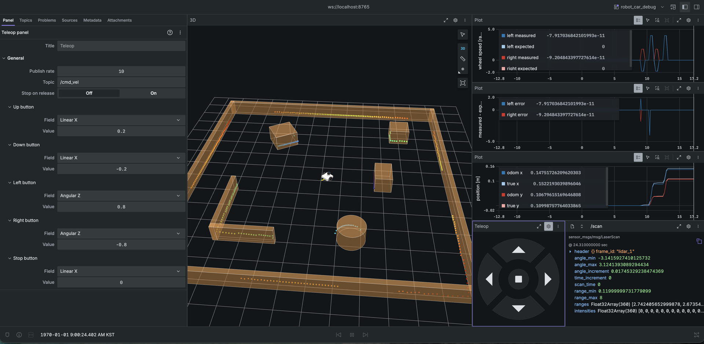

# Drive a Fusion 360 robot in Gazebo and debug it in Foxglove

This tutorial takes **Basic Robot Car**, a two-wheeled robot designed in Fusion 360, puts it in an arena built with Blender, and simulates it in Gazebo. You watch the lidar scan and the wheel speeds live in Foxglove.

By the end of the tutorial, you run this screen yourself:



- **3D (center).** The Fusion robot sits in the Blender arena, and the lidar points land on the walls and obstacles.
- **Wheel speed (top right).** For each wheel, the speed Gazebo measures next to the speed that `/cmd_vel` asks for.
- **Wheel error (second on the right).** Measured speed minus expected speed. It stays at 0 while the wheels follow the command.
- **Odometry (third on the right).** Wheel odometry (`/odom`) against the simulator's true pose (`/ground_truth/odom`), in x and y.
- **Teleop (bottom right).** Arrow buttons that drive the robot.
- **Raw Messages (bottom right).** The raw `/scan` message: its `frame_id`, its angle range, and its 360 ranges.

## How the pieces connect


## Quick start

You need only Docker Desktop and Foxglove. The repository already contains everything that Fusion 360 and Blender produce.

```bash
git clone https://github.com/LUKE-hyungjin/foxglove_basic_robot_car.git
cd foxglove_basic_robot_car
docker compose up
```

When the log shows `Server listening on port 8765`, open Foxglove:

1. Click **Open connection**, choose **Foxglove WebSocket**, and connect to `ws://localhost:8765`.
2. In the layout menu at the top right, choose **Import from file...** and open `foxglove/robot_car_debug.json`.

## Tutorial

If this is your first time, follow the steps in order. Each step uses the output of the step before it. The repository holds every step's output, so you can also start at any step.

1. [Set up your environment](docs/01-setup.md)
2. [Export a URDF from Fusion 360](docs/02-fusion-export.md)
3. [Import the URDF into the simulation package](docs/03-import-urdf.md)
4. [Build the arena map with Blender](docs/04-blender-map.md)
5. [Run the Gazebo simulation](docs/05-gazebo-sim.md)
6. [Debug the lidar in Foxglove](docs/06-foxglove-lidar.md)
7. [Debug the wheels in Foxglove](docs/07-foxglove-wheels.md)
8. [Troubleshooting](docs/08-troubleshooting.md)

## Repository layout

```text
fusion/export/basic_description/   Raw URDF and STL files exported from Fusion (never edited)
tools/import_fusion_urdf.py        Turns the raw URDF into the simulation URDF
blender/make_map.py                Blender script that builds the arena
robot_car_sim/                     ROS 2 package
  config/robot.yaml                Wheel radius, wheel separation, lidar settings (single source)
  config/bridge.yaml               Topics connected between Gazebo and ROS 2
  urdf/robot_car.urdf.xacro        Fusion URDF + Gazebo plugins
  worlds/arena.sdf                 Ground, light, arena
  launch/sim.launch.py             Starts everything
  robot_car_sim/wheel_debug.py     Expected wheel speeds and their error
  robot_car_sim/map_marker.py      Shows the arena mesh in Foxglove
  robot_car_sim/cmd_vel_timeout.py Stops the robot when /cmd_vel goes quiet
foxglove/robot_car_debug.json      Foxglove layout
scripts/                           Checks (smoke_test.sh and others)
docker/, compose.yaml              ROS 2 Jazzy + Gazebo Harmonic container
```

## Tested with

- macOS 26 (Apple Silicon, arm64), Docker Desktop 29.3
- Container: ROS 2 Jazzy, Gazebo Harmonic, foxglove_bridge 3.6
- Fusion 2706.1.17 (bundled Python 3.14), Korean UI
- Blender 5.1.1
- Foxglove 3.5.0 (macOS)

Linux and Windows (WSL2) are not tested yet.

## License

[MIT](LICENSE). This covers the code, the docs, and the Basic Robot Car model files in `fusion/export/` and `robot_car_sim/meshes/`.
