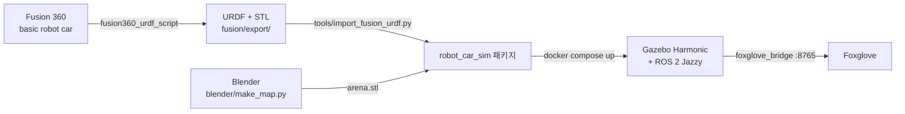

# Fusion 360 로봇을 Gazebo에서 굴리고 Foxglove로 디버그하기

Fusion 360으로 설계한 2륜 로봇 **Basic Robot Car**를 Blender로 만든 경기장에 올려 Gazebo에서 시뮬레이션합니다. 라이다 스캔과 바퀴 속도는 Foxglove에서 실시간으로 확인합니다.

이 튜토리얼을 끝내면 아래 화면을 직접 띄울 수 있습니다.


- **3D (가운데).** Fusion에서 만든 로봇이 Blender로 만든 경기장 안에 있고, 라이다 점이 벽과 장애물 표면에 겹칩니다.
- **바퀴 속도 (오른쪽 위).** Gazebo가 측정한 바퀴 속도와 `/cmd_vel`로 계산한 기대 속도를 바퀴별로 그립니다.
- **바퀴 오차 (오른쪽 두 번째).** 측정 속도에서 기대 속도를 뺀 값입니다. 바퀴가 명령대로 돌면 0에 붙어 있습니다.
- **오도메트리 (오른쪽 세 번째).** 바퀴 오도메트리(`/odom`)와 시뮬레이터의 실제 위치(`/ground_truth/odom`)를 x, y별로 비교합니다.
- **Teleop (오른쪽 아래).** 방향 버튼으로 로봇을 움직입니다.
- **Raw Messages (오른쪽 아래).** `/scan` 메시지 원문입니다. `frame_id`, 각도 범위, 거리 360개를 볼 수 있습니다.

## 전체 흐름



## 빠른 시작

Docker Desktop과 Foxglove만 있으면 됩니다. Fusion 360과 Blender로 만든 결과물은 저장소에 이미 들어 있습니다.

```bash
git clone https://github.com/LUKE-hyungjin/foxglove_basic_robot_car.git
cd foxglove_basic_robot_car
docker compose up
```

`Server listening on port 8765`가 보이면 Foxglove를 엽니다.

1. **Open connection**에서 **Foxglove WebSocket**을 고르고 `ws://localhost:8765`로 연결합니다.
2. 오른쪽 위 레이아웃 메뉴에서 **Import from file...**을 골라 `foxglove/robot_car_debug.json`을 엽니다.

## 튜토리얼

처음이라면 순서대로 따라 하세요. 각 단계는 앞 단계의 결과물을 씁니다. 다만 저장소에 결과물이 모두 들어 있으므로, 원하는 단계부터 시작해도 됩니다.

1. [환경 준비](docs/01-setup.md)
2. [Fusion 360에서 URDF 내보내기](docs/02-fusion-export.md)
3. [URDF를 시뮬레이션 패키지로 가져오기](docs/03-import-urdf.md)
4. [Blender로 경기장 맵 만들기](docs/04-blender-map.md)
5. [Gazebo 시뮬레이션 실행하기](docs/05-gazebo-sim.md)
6. [Foxglove로 라이다 디버그하기](docs/06-foxglove-lidar.md)
7. [Foxglove로 바퀴 디버그하기](docs/07-foxglove-wheels.md)
8. [문제 해결](docs/08-troubleshooting.md)

## 저장소 구조

```text
fusion/export/basic_description/   Fusion에서 내보낸 원본 URDF와 STL (수정하지 않음)
tools/import_fusion_urdf.py        원본 URDF를 시뮬레이션용으로 바꾸는 스크립트
blender/make_map.py                경기장 맵을 만드는 Blender 스크립트
robot_car_sim/                     ROS 2 패키지
  config/robot.yaml                바퀴 반지름, 바퀴 간격, 라이다 설정 (단일 출처)
  config/bridge.yaml               Gazebo와 ROS 2 사이에 연결할 토픽
  urdf/robot_car.urdf.xacro        Fusion URDF + Gazebo 플러그인
  worlds/arena.sdf                 바닥, 조명, 경기장
  launch/sim.launch.py             전체 실행
  robot_car_sim/wheel_debug.py     바퀴 속도 기대값과 오차 계산
  robot_car_sim/map_marker.py      Foxglove에 경기장 메시 표시
foxglove/robot_car_debug.json      Foxglove 레이아웃
scripts/                           동작 확인 스크립트 (smoke_test.sh 등)
docker/, compose.yaml              ROS 2 Jazzy + Gazebo Harmonic 컨테이너
```

## 확인한 환경

- macOS 26 (Apple Silicon, arm64), Docker Desktop 29.3
- 컨테이너: ROS 2 Jazzy, Gazebo Harmonic, foxglove_bridge 3.6
- Fusion 2706.1.17 (내장 Python 3.14), 한국어 UI
- Blender 5.1.1
- Foxglove 3.5.0 (macOS)

Linux와 Windows(WSL2)에서는 아직 실행해 보지 않았습니다.
