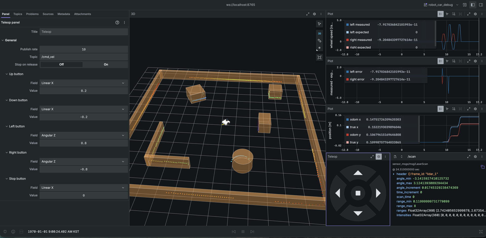

# 6. Foxglove로 라이다 디버그하기

이 단계에서는 Foxglove를 시뮬레이션에 연결하고, 준비된 레이아웃으로 라이다 스캔이 경기장 벽과 정확히 겹치는지 확인합니다.

시뮬레이션이 실행 중이어야 합니다. 꺼져 있다면 `docker compose up`으로 먼저 시작하세요.

## Foxglove 연결하기

1. Foxglove를 열고 **Open connection**을 클릭합니다.
2. **Foxglove WebSocket**을 선택합니다.
3. 주소에 `ws://localhost:8765`를 입력하고 **Open**을 클릭합니다.

`foxglove_bridge`는 컨테이너의 8765 포트에서 기다리고, `compose.yaml`이 이 포트를 내 컴퓨터로 열어 둡니다.

연결이 안 되면 호스트 터미널에서 브리지를 직접 점검합니다. 이 스크립트는 Foxglove와 같은 방식으로 접속해서 공개된 토픽을 출력합니다.

```bash
python3 scripts/check_bridge.py
```

```text
connected to ws://localhost:8765 (subprotocol foxglove.sdk.v1)
...
15 advertised topics:
...
PASS
```

## 레이아웃 가져오기

1. 오른쪽 위의 레이아웃 메뉴를 엽니다.
2. **Import from file...**을 선택합니다.
3. 저장소의 `foxglove/robot_car_debug.json`을 고릅니다.

레이아웃을 가져오면 다음 화면이 나옵니다.



레이아웃은 패널 6개로 되어 있습니다.

| 패널 | 보여 주는 것 |
| --- | --- |
| 3D | 로봇 모델, 라이다 점, 경기장, 오도메트리 |
| Plot: 바퀴 속도 | 바퀴별 측정 속도와 기대 속도 |
| Plot: 바퀴 오차 | 측정 속도 − 기대 속도 |
| Plot: odom vs 실제 | `/odom`과 `/ground_truth/odom`의 x, y |
| Teleop | 방향 버튼으로 `/cmd_vel` 보내기 |
| Raw Messages | `/scan` 메시지 원문 |

## 3D 패널에서 라이다 보기

3D 패널에는 다음이 겹쳐 보입니다.

- 주황색 반투명 경기장. `map_marker` 노드가 `/map` 토픽으로 보낸 `arena.stl`입니다.
- Fusion에서 만든 로봇. `/robot_description`을 읽어 그립니다.
- 라이다 점. `/scan` 토픽입니다.

> [!IMPORTANT]
> 레이아웃은 3D 패널의 **Scene > Mesh up axis**를 **Z-up**으로 설정합니다. Foxglove는 STL에 방향 정보가 없으면 기본으로 Y축을 위로 보고 메시를 돌려서 그립니다. 그런데 Fusion과 Blender가 내보낸 STL은 ROS 규칙(REP-103)처럼 Z축이 위입니다. 이 값이 **Y-up**이면 경기장이 90° 누워 보이고, 바퀴 메시도 누운 채로 돌아서 축이 틀린 것처럼 보입니다. 이 설정은 Foxglove를 다시 불러와야 적용됩니다.

라이다 점이 경기장 벽의 안쪽 면에 정확히 붙어 있으면 라이다, TF, 맵이 모두 맞는 것입니다. 점이 벽에서 떨어져 있거나 회전되어 있으면 아래를 의심하세요.

- 점 전체가 벽과 평행하게 밀려 있으면 로봇 위치가 틀린 것입니다. 7단계의 오도메트리를 확인하세요.
- 점 전체가 회전되어 있으면 로봇 방향(yaw)이 틀린 것입니다.
- 점이 벽 바깥까지 이어지면 맵과 Gazebo 월드가 서로 다른 STL을 쓰는 것입니다.

> [!NOTE]
> 메시가 보이지 않으면 Foxglove가 `package://` 경로의 STL을 받지 못한 것입니다. `foxglove_bridge`는 이 파일을 웹소켓으로 보내 줍니다. `scripts/check_bridge.py` 출력에 `fetchAsset ... bytes` 줄이 있는지 확인하세요.

## Raw Messages에서 거리 읽기

Raw Messages 패널에서 `/scan` 메시지를 펼칩니다.

| 필드 | 값 | 뜻 |
| --- | --- | --- |
| `header.frame_id` | `lidar_1` | 라이다 링크 프레임 |
| `angle_min` | -3.1416 | 첫 빔의 각도 (뒤쪽) |
| `angle_increment` | 0.01745 | 빔 간격 1° |
| `ranges` | 360개 | 각 빔의 거리 (m) |

빔 번호 `i`의 각도는 `angle_min + i × angle_increment`입니다. 정면(0°)은 `ranges[180]`입니다. 이 값이 4단계에서 정면에 둔 상자까지의 거리 1.249 m와 같은지 확인하세요.

## 직접 바꿔 보기

라이다 해상도를 두 배로 올려 봅니다. `robot_car_sim/config/robot.yaml`에서 `samples`를 바꿉니다.

```yaml
lidar:
  samples: 720
```

시뮬레이션을 다시 시작합니다.

```bash
docker compose down
docker compose up
```

`ranges`는 720개가 되고, 빔 간격은 0.5°가 됩니다. 정면은 이제 `ranges[360]`이고, 값은 같은 1.249 m입니다. 3D 패널의 점도 두 배로 촘촘해집니다. 확인했으면 `samples`를 360으로 되돌리세요.

다음 단계: [Foxglove로 바퀴 디버그하기](07-foxglove-wheels.md)
